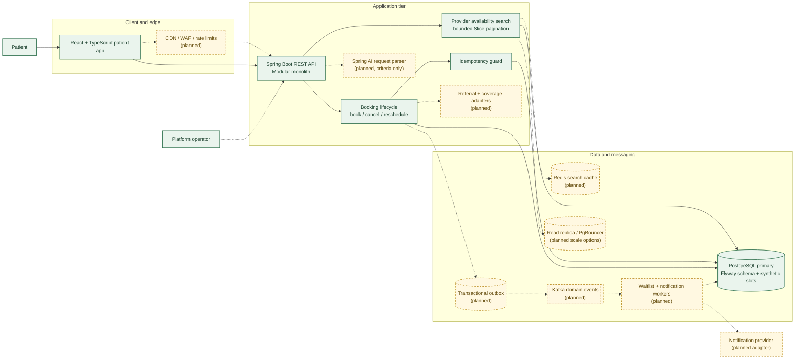

# Care Access Orchestration Platform — High-Level Design

## Purpose

A patient-facing platform for provider availability search and appointment administration. It uses synthetic data and supports logistics only; it does not diagnose, triage, or recommend treatment.

This HLD separates the current implementation from the proposed scale architecture. Solid nodes show components already present in the repository. Dashed nodes are planned and are not yet implemented.

## System context and component view

**Legend:** solid arrows are current request/data paths. Dashed arrows/nodes indicate proposed integrations or scale-out paths.

## Current implementation

- **Web client:** React + TypeScript app for search, booking, appointments, and cancellation.
- **API:** Spring Boot REST API. Search accepts specialty, ZIP code, date range, page, and size; size is capped at 50 and the date window at 90 days. Search returns a `Slice`, avoiding an exact count query per page.
- **Booking safety:** booking and rescheduling use idempotency keys. Slot reads are locked in a transaction; a partial unique index prevents more than one active booking per slot.
- **Database:** PostgreSQL with Flyway migrations and deterministic synthetic availability.
- **Operations:** Spring Boot Actuator health and metrics endpoints.

The `X-Demo-Patient` header is a local demo identity, not authentication. Do not use it for a public or production deployment.

## Proposed production topology for growth

Keep the Spring Boot code as a modular monolith initially. Run stateless API replicas behind an ingress/load balancer. Put static frontend assets behind a CDN. Configure API pool limits against the PostgreSQL connection budget before increasing replica counts.

PostgreSQL remains authoritative for booking decisions. Add Redis only for short-lived search results; a cache hit must never authorize a booking. Add a read replica only when measured read traffic warrants it, and route final availability checks and writes to the primary.

Use a transactional outbox for booking lifecycle events. Kafka consumers can then process notifications and waitlist matching independently from the API request path. Consumer effects should be idempotent, retry transient errors with bounded backoff, and route poison events to a dead-letter queue.

## Key request flows

### Provider search

1. The client submits validated search fields and a page number.
2. The API enforces a maximum page size and a 90-day date window.
3. The repository queries indexed open slots and returns only one bounded `Slice`.
4. The client follows `last` / page metadata to navigate. Results may become stale; they are informational until booking succeeds.

### Book an appointment

1. The client sends a slot ID and an `Idempotency-Key`.
2. The API scopes the key to the demo patient, compares request hashes, and returns the earlier booking for an identical retry.
3. In a database transaction, the API locks the authoritative slot row and checks that the slot remains open.
4. The API marks the slot booked, inserts a booking, and persists the idempotency record.
5. PostgreSQL’s active-slot partial unique index provides a final duplicate-booking guard.
6. Planned: write an outbox event in this same transaction and publish it asynchronously after commit.

### Cancel or reschedule

- Cancellation verifies patient ownership and releases the slot in a transaction.
- Rescheduling verifies ownership and locks both slots in deterministic ID order before switching the active booking.
- Planned: emit lifecycle events through the outbox so waitlist matching and notifications do not block the API response.

## Data ownership and consistency

- **PostgreSQL primary:** source of truth for slots, bookings, and idempotency records.
- **Redis (planned):** disposable search acceleration only; cache loss falls back to PostgreSQL.
- **Kafka (planned):** asynchronous lifecycle delivery; outbox/inbox deduplication handles at-least-once delivery.
- **AI (planned):** extracts constrained search criteria only. Eligibility, availability, and booking decisions remain deterministic backend logic.

## Availability and failure boundaries

| Component issue | Intended behavior |
|---|---|
| Search cache unavailable | Bypass cache and query PostgreSQL under a concurrency limit. |
| Kafka unavailable | Continue committing user actions with outbox records; publish after recovery. |
| Referral/coverage adapter timeout | Bound the timeout and fail safely when a required check cannot be completed. Never hold a slot lock while waiting on the adapter. |
| AI unavailable or malformed output | Let the patient edit structured filters or continue without natural-language parsing. |
| API replica failure | Route requests to healthy replicas; persist all durable state in PostgreSQL. |

## Security and privacy boundary

- Replace demo identity with OIDC authentication before exposing the app.
- Derive patient identity from the verified authentication context, never from an arbitrary client-supplied ID.
- Keep synthetic data in the portfolio environment.
- Avoid logging raw prompts or unnecessary patient data.
- Do not expose booking or patient data to the LLM. It has no booking tools.

## Capacity assumptions

“10,000 users” is treated as 10,000 registered users, not 10,000 concurrent users. The separate [scaling plan](SCALING_PLAN.md) defines provisional peak assumptions, service objectives, database connection budgeting, load scenarios, and rollout sequencing. Those values are planning targets and require measurement before making a capacity claim.
