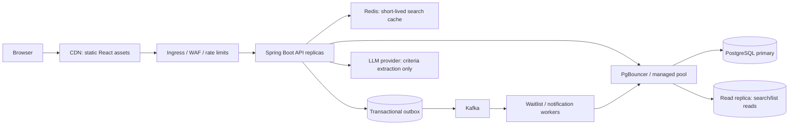

# Scaling Plan: 10,000 Patients

## Goal and assumptions

“10,000 users” is ambiguous: 10,000 registered accounts do not mean 10,000 simultaneous requests. This plan treats 10,000 as registered synthetic/demo patients and uses an initial capacity envelope of 100 active users at peak, with short bursts around 100 API requests/second. These are planning assumptions, not measured capacity claims. Replace them with observed traffic and load-test results before production sizing.

### Proposed service objectives

| User-visible operation | Initial objective |
|---|---|
| Provider/availability search | p95 under 500 ms at the agreed load, excluding browser network time |
| Booking/reschedule | p95 under 1 s for local deterministic checks; no duplicate active slot bookings |
| Cancellation | Commit within 1 s; downstream waitlist/notification work is asynchronous |
| API availability | 99.9% monthly for the service tier, excluding announced maintenance |
| Event processing | 99% of ordinary lifecycle events processed within 10 s; alert on outbox lag |

These are target objectives for a future benchmark, not current measurements or guarantees.

## Target architecture

Keep the application as a modular monolith at 10,000 users. Run stateless API replicas behind a load balancer and scale them horizontally. Keep worker deployments separate so a notification backlog does not consume request-serving capacity. Split a module into a separate service only when its load, deployment cadence, or failure isolation justifies the added operational cost.

## Request and data paths

### Search path

1. Validate and normalize specialty, postal code, visit mode, and bounded date range.
2. Require pagination (`page`, `size`) with a small maximum page size; return a `Slice` instead of a `Page` so ordinary browsing avoids an exact total-count query. Never materialize every matching slot.
3. Query an indexed read model. Cache common search results in Redis for a short TTL (for example, 15–30 seconds), with a cache version and `asOf` time.
4. On a cache miss, use PostgreSQL. A read replica can serve provider/search/list reads after replica lag is monitored. Keep booking, cancellation, reschedule, and final availability validation on the primary.
5. Display freshness and pagination metadata. Search results are suggestions, never a reservation.

Suggested indexes after checking actual query plans:

- `appointment_slot (specialty, postal_code, starts_at) WHERE status='OPEN'`
- `booking (patient_id, created_at DESC)`
- `provider (specialty_code, active)`
- waitlist partial indexes for active entries by provider/specialty and preference window

The current `GET /providers` is paginated and uses a `Slice`, avoiding a count query for each browse request. It still filters denormalized slot fields; query-plan measurement and a normalized provider/clinic read model remain follow-up work. As provider/clinic data grows, normalize provider and clinic records and consider a denormalized read projection for search rather than overloading booking tables.

### Booking path

- Keep the primary PostgreSQL database as the authority for slot ownership.
- Validate referral/coverage before locking a slot; keep external integration timeouts bounded and do not hold a database lock across network calls.
- Use one transaction and a conditional state transition or short `SELECT ... FOR UPDATE` lock. Enforce one active booking per slot with a partial unique index.
- Scope idempotency keys to the authenticated patient/client. Persist request hash and result. Handle concurrent requests using the same key as a first-class race (atomic insert/claim and return the winner's result), not as an unhandled unique-key exception.
- Reschedule by locking old and target slots in stable order, checking ownership, and atomically switching the booking. On any error, keep the original booking intact.
- Emit domain events through an outbox in the same transaction; never publish “booking confirmed” before the commit.

The current implementation has slot row locks, an active-slot partial index, and idempotency records. Before relying on it at load, harden same-key concurrent retries, add a request-size and date-range bound, and test rollback behavior for simultaneous reschedules.

## PostgreSQL and connection capacity

- Start with one primary sized from load tests, automated backups, point-in-time recovery, and tested restore procedures.
- Add a managed connection pool or PgBouncer before adding many API replicas. Set pool limits from the database connection budget: `API replicas × pool max + worker pools + admin reserve` must stay below the database limit.
- Keep transactions short; do not make LLM or payer/referral network calls inside them.
- Monitor active/idle connections, lock wait time, deadlocks, slow queries, pool wait time, CPU, I/O, storage growth, and replica lag.
- Use a read replica only for reads tolerant of replication lag. Route booking decisions and the final fresh slot read to the primary.
- Partition very large, time-oriented event/audit tables only after growth and query plans demonstrate a need. Avoid partitioning core booking tables prematurely.

## Redis and cache correctness

- Cache only read/search results, with normalized keys, short TTL, explicit versioning, and bounded memory/eviction policy.
- Do not cache booking outcomes as authority or use Redis locks as the only double-booking guard.
- Treat Redis loss as a cache miss and fall back to the database with rate limits/circuit protection. Add a concurrency limit to protect PostgreSQL during a cache outage.
- Track hit ratio, evictions, memory, latency, and fallback rate. If availability invalidation becomes complex, tolerate brief staleness in search and revalidate on booking.

## Kafka and asynchronous work

- Use a PostgreSQL outbox relay, publishing stable event IDs after the transaction commits. The relay claims rows in batches and can use `FOR UPDATE SKIP LOCKED` to allow multiple relay workers.
- Partition lifecycle topics by aggregate/slot key so related events preserve order. Choose partition count from measured throughput and consumer parallelism, not from the user count alone.
- Make consumers idempotent with an inbox/deduplication key. Retry transient failures with bounded backoff, then dead-letter and alert; provide safe replay tooling.
- Scale waitlist and notification workers independently based on Kafka lag and processing time. Notification vendor failures must not roll back a confirmed booking.
- Keep event payloads small and minimize patient data; carry identifiers and necessary scheduling fields.

## Spring Boot and edge scaling

- Store no session state in API memory. Use OIDC and verify identity at the API boundary; do not use the demo patient header outside local development.
- Run at least two API replicas in production across separate failure zones, with readiness/liveness probes and graceful shutdown. Use autoscaling based on request concurrency/latency and CPU, with min/max bounds to protect the database.
- Apply edge rate limits by identity and IP, request body limits, timeouts, and per-integration bulkheads. Apply bounded concurrency for expensive search and AI parsing.
- Use an LLM only to parse constrained search criteria. Keep model calls off critical booking transactions, impose deadlines/token budgets, and use deterministic fallback filters.
- Add tracing across edge, API, PostgreSQL, Redis, Kafka, and adapters. Use structured logs with correlation IDs and no raw prompts or unnecessary personal data.

## Failure behavior

| Failure | Expected behavior |
|---|---|
| Redis unavailable | Search falls back to PostgreSQL under a protective concurrency limit; booking remains available if the database is healthy. |
| Kafka unavailable | Booking/cancellation transactions still commit with outbox rows; relay publishes when Kafka recovers. |
| Read replica lagging | Route freshness-sensitive reads to primary or mark cached/read-model data stale; all booking validation stays on primary. |
| Referral/coverage adapter slow | Fail closed for a required check with a clear retry path; never hold a slot lock while waiting. |
| LLM unavailable/invalid output | Offer editable filters or a clarification prompt; search and booking remain available without AI. |
| One API replica unhealthy | Remove it from readiness and route requests to healthy replicas; request state is recoverable from PostgreSQL. |

## Capacity testing and rollout

1. Add bounded pagination and realistic synthetic data (provider, slot, booking, and waitlist distributions).
2. Create repeatable load scenarios: mostly search, mixed search/booking, hot-provider contention, cancellation bursts, and slow/failing adapters.
3. Increase offered load gradually to the agreed peak and burst envelope. Record p50/p95/p99, error rates, throughput, database pool wait, locks, cache behavior, and Kafka lag.
4. Run contention tests where many requests target the same slot and same idempotency key. Assert one active booking and deterministic responses.
5. Test dependency loss: Redis down, Kafka down, read replica lag, and adapter timeout. Verify recovery and absence of lost committed events.
6. Right-size API, database, pool, cache, and partitions from those results. Do not claim “supports 10,000 users” until the agreed workload passes and the test setup/results are documented.

## Recommended implementation order

1. Pagination, date-range limits, stable DTOs, and validated query plans.
2. Fix concurrent idempotency-key races and add concurrency/integration tests.
3. Add metrics/tracing and define dashboards/alerts before adding infrastructure.
4. Add Redis search caching with database fallback and a stale-availability UI signal.
5. Add transactional outbox and Kafka worker for booking/cancellation notifications and waitlist matching.
6. Deploy stateless API replicas, managed PostgreSQL/pooling, backups, and edge rate limits.
7. Add a read replica only if measured read load or latency requires it.

At this scale, the primary limits are likely to be unbounded search queries, database connection/lock behavior, and dependency failures—not the number of registered accounts by itself. Measure those paths first.
